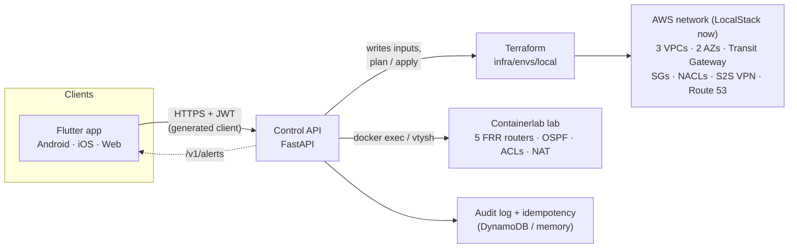

# Cloud NetOps

A multi-site company network, designed in Cisco Packet Tracer, rebuilt as
code for AWS with Terraform, and run from a Flutter app (Android, iOS and
Web) through a control API.

**Status:** phases 1–6 are built and tested, and everything runs locally.
Nothing touches real AWS until the deployment phase is approved
([ADR 0001](docs/decisions/0001-local-only-until-aws-approval.md)). The
story behind it is in the [case study](docs/case-study.md), and the demo
script is in [`docs/demo-script.md`](docs/demo-script.md).

## Architecture



| Layer | Local (now) | Cloud (AWS phase) |
| --- | --- | --- |
| Design | [`docs/network-design.md`](docs/network-design.md) + Packet Tracer configs | same |
| Routers / OSPF | Containerlab + FRR ([`lab/`](lab/)) | Containerlab on one small EC2 |
| VPCs, TGW, security, VPN | LocalStack ([`infra/`](infra/)) | AWS via `terraform`, budget alarm first |
| Control API | FastAPI on `localhost:8000` ([`api/`](api/)) | Lambda + API Gateway + Cognito |
| Audit log | memory or DynamoDB on LocalStack | DynamoDB |
| App | Flutter `local` flavor ([`app/`](app/)) | Flutter `aws` flavor + FCM |

On-prem to cloud mapping: site → VPC, VLAN → subnet (×2 AZs), core router
→ Transit Gateway, OSPF ABR summary → TGW route propagation, ACL →
security group / NACL, WAN link → TGW attachment, on-prem link →
site-to-site VPN, DNS server → Route 53 private zone.

## Requirements

- Windows 11, macOS or Linux, with Docker (Docker Desktop is fine), Git and
  the GitHub CLI.
- Python 3.11, Terraform 1.17, Flutter 3.35.
- A free LocalStack account token, only for `terraform apply`. Everything
  else works without it.

## Run it

```sh
git clone https://github.com/King102020/cloud-netops.git && cd cloud-netops
cp .env.example .env && pip install pre-commit && pre-commit install

./lab/clab.sh deploy                       # 1. routers (Git Bash on Windows)

cd api && python -m venv .venv && .venv/bin/pip install -e ".[dev]"
.venv/bin/uvicorn --factory cnops_api.main:create_app --port 8000   # 2. API

cd app && flutter run -d chrome --web-port 8080 \
  --dart-define-from-file=config/local.json                          # 3. app
```

Sign in as `operator` / `operator-local`. Then try the demo: take the
**hq-br2** link down and watch OSPF reroute over the backup link
([demo script](docs/demo-script.md)).

Each layer's README has the details:
[lab](lab/README.md) · [infra](infra/README.md) · [api](api/README.md) ·
[app](app/README.md) · [Packet Tracer](packet-tracer/README.md) ·
[runbooks](docs/runbooks/).

## Quality gate

```powershell
.\tool\check.ps1     # Windows
./tool/check.sh      # WSL / macOS / Linux
```

CI runs the same gates per area ([`.github/workflows`](.github/workflows/)).

| Layer | Checks | Result |
| --- | --- | --- |
| Repo | pre-commit, gitleaks | clean |
| Lab | clean deploy + 58 pytest checks (OSPF, ACLs, NAT, failover) | all pass |
| Terraform | fmt, validate, 8 `terraform test`s (mocked), tflint, checkov | pass; checkov 178 ✓ / 0 ✗ |
| API | ruff, `mypy --strict`, 73 tests, OpenAPI drift, pip-audit | ~97% coverage |
| App | analyze, format, 60 tests (unit/cubit/widget/golden), live contract | ~94% coverage; web + APK build |

## Repo layout

| Path | What |
| --- | --- |
| `docs/` | Standards, network design, ADRs, diagrams, runbooks, case study |
| `packet-tracer/` | Build guide and paste-ready IOS configs |
| `lab/` | Containerlab topology, FRR configs, acceptance tests |
| `infra/` | Terraform modules and `envs/local` (`envs/aws` later) |
| `api/` | FastAPI control API, tests, committed `openapi.json` |
| `app/` | Flutter app for Android, iOS and Web |
| `tool/` | Local quality-gate scripts |

Engineering rules are in [`docs/STANDARDS.md`](docs/STANDARDS.md), and
decisions are in [`docs/decisions/`](docs/decisions/).

## What it can and cannot do

**Can:**
- show the live topology, device health and OSPF neighbours;
- take WAN links down and up, with OSPF rerouting for real in the lab;
- add, toggle and remove firewall rules and create subnets, all through
  Terraform;
- keep an audit log of every change;
- alert on link and adjacency failures.

**Cannot (yet):**
- run on real AWS, which waits for the deployment phase;
- push notifications while the app is closed (that needs Firebase);
- emulate everything AWS does. LocalStack stores but does not forward
  VPN or TGW traffic. Each such gap, and how it is tested instead, is in
  [`docs/local-gaps.md`](docs/local-gaps.md).

## License

[MIT](LICENSE)
