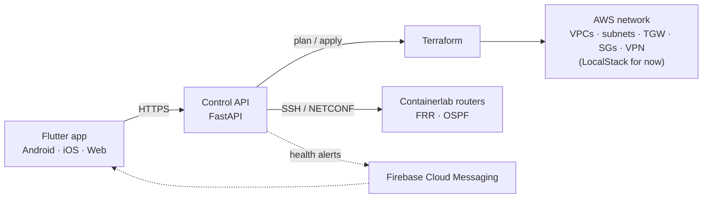

# Cloud NetOps

A multi-site company network, designed in Cisco Packet Tracer, rebuilt as
code on AWS with Terraform, and managed from a Flutter app through a small
control API.

**Status:** Phase 1 — network design. Everything runs locally. Nothing
touches real AWS yet.

## Architecture



| Layer | Local (now) | Cloud (later) |
| --- | --- | --- |
| Design | Packet Tracer `.pkt` + [`docs/network-design.md`](docs/network-design.md) | same |
| Routers / OSPF | Containerlab + FRR in WSL2 | Containerlab on one small EC2 |
| VPCs, subnets, routing | LocalStack via `lstk terraform` | AWS via `terraform` |
| Control API | FastAPI on `localhost:8000` | Lambda + API Gateway + Cognito |
| State / audit log | DynamoDB on LocalStack | DynamoDB |
| App | Flutter `local` flavor | Flutter `aws` flavor |

## Requirements

- Windows 11 with WSL2 Ubuntu 22.04, or macOS / Linux
- Docker, Git, GitHub CLI
- Python 3.11+ and [`pre-commit`](https://pre-commit.com)
- Later phases: Containerlab, Terraform 1.17, `lstk` (LocalStack), Flutter 3.35

## Run

```sh
git clone https://github.com/King102020/cloud-netops.git
cd cloud-netops
cp .env.example .env        # dummy LocalStack values only
pip install pre-commit
pre-commit install
```

Each phase adds its own run steps here and a runbook in
[`docs/runbooks/`](docs/runbooks/).

## Quality gate

```powershell
.\tool\check.ps1     # Windows
```

```sh
./tool/check.sh      # WSL / macOS / Linux
```

The script runs pre-commit (formatting, YAML/JSON checks, gitleaks) and the
checks for every layer that exists. CI runs the same commands.

## Repo layout

| Path | What |
| --- | --- |
| `docs/` | Standards, network design, ADRs, diagrams, runbooks |
| `packet-tracer/` | Packet Tracer `.pkt` files |
| `lab/` | Containerlab topology, FRR configs, connectivity tests |
| `infra/` | Terraform modules and `envs/local`, `envs/aws` |
| `api/` | FastAPI control API and tests |
| `app/` | Flutter app |
| `tool/` | Local quality-gate scripts |

Engineering rules: [`docs/STANDARDS.md`](docs/STANDARDS.md).
Architecture decisions: [`docs/decisions/`](docs/decisions/).

## What it can and cannot do

**Can (planned):** show the live topology, device and OSPF health; add or
remove firewall rules; create subnets; take links up and down; keep an
audit log of every change.

**Cannot:** run against real AWS until the owner approves that phase. Some
AWS features are emulated or mocked locally; each gap is listed in
[`docs/local-gaps.md`](docs/local-gaps.md).

## Tests

Added per phase: `lab/tests` (connectivity, OSPF), Terraform validate/plan,
`pytest` for the API, Flutter unit/widget/golden tests.

## License

[MIT](LICENSE)
