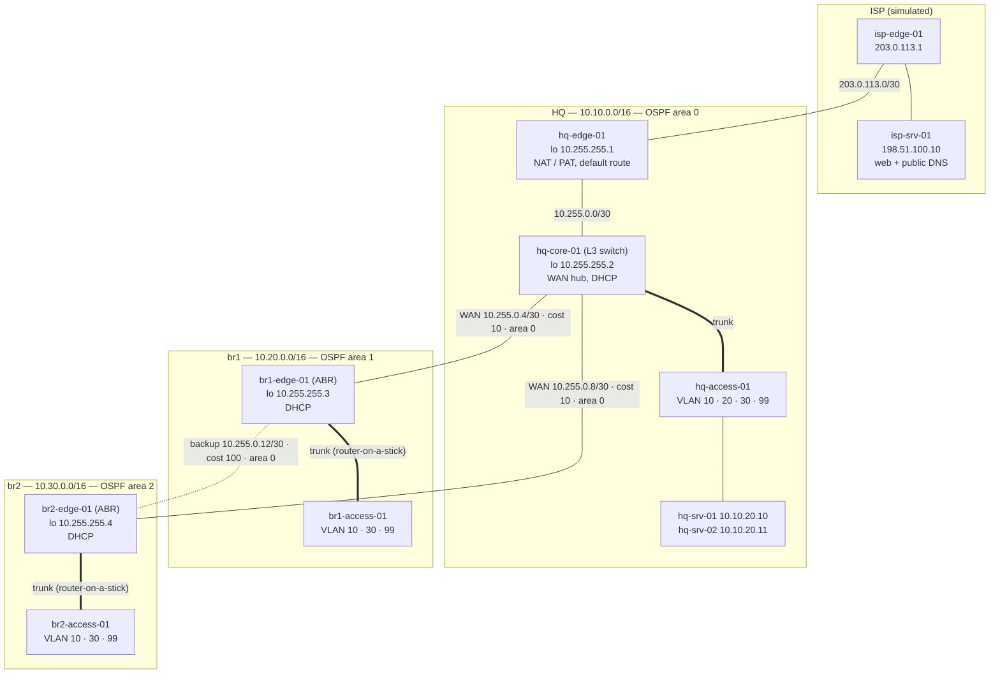

# Network design

The source of truth for the Cloud NetOps network. The Packet Tracer file
(`packet-tracer/`), the Containerlab lab (`lab/`) and the Terraform code
(`infra/`) are all built from this document. If they disagree, this
document wins and the others are fixed.

**Status:** Draft for review (phase 1). Region: `ap-south-1` (Mumbai).

## 1. Overview

A small company with one head office (**hq**) and two branches (**br1**,
**br2**).

- HQ hosts the servers and the only internet exit.
- Branches connect to HQ over WAN links (hub and spoke).
- A direct br1 ↔ br2 backup link keeps branches talking if a hub link fails.
- Routing is OSPF. Every site router does local DHCP. HQ does NAT for the
  whole company.

Editable source: [`diagrams/network-topology.mmd`](diagrams/network-topology.mmd).

## 2. Addressing rules

All internal addresses are private ([RFC 1918](https://www.rfc-editor.org/rfc/rfc1918))
inside `10.0.0.0/8`. Nothing overlaps, on-prem or cloud.

| Rule | Example |
| --- | --- |
| Each on-prem site gets one `/16`: hq `10.10`, br1 `10.20`, br2 `10.30` | br1 = `10.20.0.0/16` |
| Third octet = VLAN ID | br1 Users (VLAN 10) = `10.20.10.0/24` |
| Cloud VPC second octet = on-prem second octet + 100 | hq VPC = `10.110.0.0/16` |
| Gateway is always `.1` | `10.20.10.1` |
| `.2`–`.99` static (switches, servers, printers) | `10.10.20.10` = hq-srv-01 |
| `.100`–`.199` DHCP pool | |
| `.200`–`.254` reserved (future static / appliances) | |

So you can read any address: `10.30.30.157` is a **br2 guest** on DHCP.

### Top-level allocation

| Block | Use |
| --- | --- |
| `10.10.0.0/16` | hq (on-prem) |
| `10.20.0.0/16` | br1 (on-prem) |
| `10.30.0.0/16` | br2 (on-prem) |
| `10.40.0.0` – `10.99.255.255` | Reserved: future on-prem sites (br3 = `10.40.0.0/16`, …) |
| `10.110.0.0/16` | hq VPC (cloud, phase 3) |
| `10.120.0.0/16` | br1 VPC (cloud, phase 3) |
| `10.130.0.0/16` | br2 VPC (cloud, phase 3) |
| `10.140.0.0` – `10.199.255.255` | Reserved: future VPCs (br3 = `10.140.0.0/16`, …) |
| `10.255.0.0/24` | Point-to-point transit links (`/30`) |
| `10.255.255.0/24` | Router loopbacks / OSPF router IDs (`/32`) |
| `169.254.10.0/24` | Reserved: AWS site-to-site VPN tunnel inside addresses (AWS requires `169.254.0.0/16`) |
| `203.0.113.0/24` | Simulated ISP uplink (TEST-NET-3, [RFC 5737](https://www.rfc-editor.org/rfc/rfc5737)) |
| `198.51.100.0/24` | Simulated internet (TEST-NET-2) |
| `172.20.20.0/24` | Containerlab out-of-band management (lab only, phase 2) |

Avoided on purpose: `172.17.0.0/16` (Docker default bridge) and
`192.168.0.0/16` (home routers, so lab traffic never collides with your
own LAN).

We use `/30` for links rather than `/31` because Packet Tracer handles `/31`
poorly. FRR and AWS do not care either way.

## 3. VLANs

The same VLAN IDs and names are used at every site.

| VLAN | Name | Purpose | hq | br1 | br2 |
| --- | --- | --- | --- | --- | --- |
| 10 | `USERS` | Staff PCs | ✓ | ✓ | ✓ |
| 20 | `SERVERS` | DNS, web, file servers | ✓ | — | — |
| 30 | `GUEST` | Visitor Wi-Fi, internet only | ✓ | ✓ | ✓ |
| 99 | `MGMT` | Switch / router management | ✓ | ✓ | ✓ |
| 999 | `NATIVE-UNUSED` | Native VLAN on trunks, carries nothing | ✓ | ✓ | ✓ |

Unused access ports are shut down and put in VLAN 999. Trunks allow only
the VLANs listed for that site.

## 4. IP plan

### 4.1 Site subnets

| Site | VLAN | Subnet | Gateway | DHCP pool | Static range | Gateway on |
| --- | --- | --- | --- | --- | --- | --- |
| hq | 10 USERS | `10.10.10.0/24` | `10.10.10.1` | `.100`–`.199` | `.2`–`.99` | hq-core-01 SVI |
| hq | 20 SERVERS | `10.10.20.0/24` | `10.10.20.1` | none (static) | `.2`–`.99` | hq-core-01 SVI |
| hq | 30 GUEST | `10.10.30.0/24` | `10.10.30.1` | `.100`–`.199` | `.2`–`.99` | hq-core-01 SVI |
| hq | 99 MGMT | `10.10.99.0/27` | `10.10.99.1` | none (static) | `.2`–`.30` | hq-core-01 SVI |
| br1 | 10 USERS | `10.20.10.0/24` | `10.20.10.1` | `.100`–`.199` | `.2`–`.99` | br1-edge-01 `.10` subif |
| br1 | 30 GUEST | `10.20.30.0/24` | `10.20.30.1` | `.100`–`.199` | `.2`–`.99` | br1-edge-01 `.30` subif |
| br1 | 99 MGMT | `10.20.99.0/27` | `10.20.99.1` | none (static) | `.2`–`.30` | br1-edge-01 `.99` subif |
| br2 | 10 USERS | `10.30.10.0/24` | `10.30.10.1` | `.100`–`.199` | `.2`–`.99` | br2-edge-01 `.10` subif |
| br2 | 30 GUEST | `10.30.30.0/24` | `10.30.30.1` | `.100`–`.199` | `.2`–`.99` | br2-edge-01 `.30` subif |
| br2 | 99 MGMT | `10.30.99.0/27` | `10.30.99.1` | none (static) | `.2`–`.30` | br2-edge-01 `.99` subif |

MGMT is a `/27` (30 hosts) because it only holds network gear. The rest of
each `10.x.99.0/24` stays free for growth.

### 4.2 Transit links

| Link | Subnet | Side A | Side B | OSPF area | OSPF cost |
| --- | --- | --- | --- | --- | --- |
| HQ edge ↔ core | `10.255.0.0/30` | hq-edge-01 `10.255.0.1` | hq-core-01 `10.255.0.2` | 0 | 1 |
| HQ ↔ br1 (WAN) | `10.255.0.4/30` | hq-core-01 `10.255.0.5` | br1-edge-01 `10.255.0.6` | 0 | 10 |
| HQ ↔ br2 (WAN) | `10.255.0.8/30` | hq-core-01 `10.255.0.9` | br2-edge-01 `10.255.0.10` | 0 | 10 |
| br1 ↔ br2 (backup) | `10.255.0.12/30` | br1-edge-01 `10.255.0.13` | br2-edge-01 `10.255.0.14` | 0 | 100 |
| ISP uplink | `203.0.113.0/30` | isp-edge-01 `203.0.113.1` | hq-edge-01 `203.0.113.2` | — (static) | — |

### 4.3 Loopbacks (OSPF router IDs)

| Device | Loopback0 / router ID |
| --- | --- |
| hq-edge-01 | `10.255.255.1/32` |
| hq-core-01 | `10.255.255.2/32` |
| br1-edge-01 | `10.255.255.3/32` |
| br2-edge-01 | `10.255.255.4/32` |

### 4.4 Device inventory

Naming: `<site>-<role>-<n>`. Packet Tracer models are suggestions that have
enough ports.

| Device | Role | PT model | Mgmt IP | Key interfaces |
| --- | --- | --- | --- | --- |
| hq-edge-01 | Internet edge, NAT, ASBR | ISR4331 | `10.255.255.1` (lo) | Gi0/0/0 → ISP (outside) · Gi0/0/1 → hq-core-01 (inside) |
| hq-core-01 | L3 core, WAN hub, DHCP for HQ | 3650-24PS | `10.10.99.1` | Gi1/0/24 → hq-edge-01 · Gi1/0/23 → br1 · Gi1/0/22 → br2 · Gi1/0/1 trunk → hq-access-01 |
| hq-access-01 | Access switch | 2960-24TT | `10.10.99.2` | Fa0/1–10 VLAN 10 · Fa0/11–15 VLAN 20 · Fa0/16–20 VLAN 30 · Gi0/1 trunk |
| br1-edge-01 | Branch router, ABR, DHCP | ISR4331 | `10.20.99.1` | Gi0/0/0 → hq-core-01 · Gi0/0/1 → br2-edge-01 · Gi0/0/2 trunk → br1-access-01 |
| br1-access-01 | Access switch | 2960-24TT | `10.20.99.2` | Fa0/1–10 VLAN 10 · Fa0/16–20 VLAN 30 · Gi0/1 trunk |
| br2-edge-01 | Branch router, ABR, DHCP | ISR4331 | `10.30.99.1` | Gi0/0/0 → hq-core-01 · Gi0/0/1 → br1-edge-01 · Gi0/0/2 trunk → br2-access-01 |
| br2-access-01 | Access switch | 2960-24TT | `10.30.99.2` | Fa0/1–10 VLAN 10 · Fa0/16–20 VLAN 30 · Gi0/1 trunk |
| hq-srv-01 | DNS (`cnops.internal`) + web | Server-PT | `10.10.20.10` | VLAN 20 |
| hq-srv-02 | File server | Server-PT | `10.10.20.11` | VLAN 20 |
| isp-edge-01 | Simulated ISP | 2911 | — | Gi0/0 → hq-edge-01 · Gi0/1 → isp-srv-01 (`198.51.100.1/24`) |
| isp-srv-01 | "Internet" web + public DNS | Server-PT | `198.51.100.10` | — |

Test hosts (DHCP): `hq-pc-01`, `hq-guest-01`, `br1-pc-01`, `br1-guest-01`,
`br2-pc-01`, `br2-guest-01`.

## 5. Routing (OSPF)

OSPFv2, process 1, on every company router. `isp-edge-01` does not run OSPF.

| Setting | Value | Why |
| --- | --- | --- |
| Router ID | Loopback0 (§4.3) | Stable; does not change when an interface goes down |
| Areas | Area 0 = HQ + all transit links. Area 1 = br1 LANs. Area 2 = br2 LANs | Branch routers are ABRs, so each branch can be summarised |
| Summaries | br1-edge-01: `area 1 range 10.20.0.0 255.255.0.0`. br2-edge-01: `area 2 range 10.30.0.0 255.255.0.0` | HQ sees one route per branch. This is the same as one CIDR per VPC in the cloud |
| Reference bandwidth | `auto-cost reference-bandwidth 10000` (10 Gb/s) | Default 100 Mb/s makes every link ≥ 100 Mb/s cost 1 |
| Link costs | Set explicitly (§4.2): WAN 10, backup 100 | The backup link is used only when a hub link fails |
| Passive interfaces | `passive-interface default`, then `no passive-interface` on transit links only | No OSPF hellos towards user, guest or server VLANs |
| Default route | hq-edge-01: `ip route 0.0.0.0 0.0.0.0 203.0.113.1` + `default-information originate` | All sites exit to the internet through HQ NAT |
| Network type | `point-to-point` on all `/30` transit links | No DR/BDR election, faster convergence |

**Expected paths:**

- br1 ↔ br2: br1-edge-01 → hq-core-01 → br2-edge-01 (cost 20). The direct
  backup link (cost 100) is not used.
- If HQ ↔ br2 goes down: br2 traffic to HQ goes br2 → br1 → hq-core-01
  (cost 110). This is the "link down" demo for phase 4.
- Internet from any site: → hq-core-01 → hq-edge-01 → NAT → ISP.

## 6. Security (ACLs)

Default deny. Every ACL ends in an explicit `deny ip any any log` so drops
show up in logs. Each line has a remark that says why it exists.

### 6.1 `GUEST-IN`

Applied inbound on every VLAN 30 gateway (hq-core-01 SVI 30,
br1-edge-01 Gi0/0/2.30, br2-edge-01 Gi0/0/2.30).

| # | Action | Match | Why |
| --- | --- | --- | --- |
| 10 | permit | `udp any eq 68 any eq 67` | DHCP from guests to the gateway |
| 20 | deny | `ip any 10.0.0.0 0.255.255.255` | No access to anything internal |
| 30 | deny | `ip any 172.16.0.0 0.15.255.255` | RFC 1918 |
| 40 | deny | `ip any 192.168.0.0 0.0.255.255` | RFC 1918 |
| 50 | permit | `ip <site guest subnet> any` | Internet only. Also blocks spoofed source addresses |
| 60 | deny | `ip any any log` | Default deny |

Guests get the public DNS server (`198.51.100.10`), not the internal one.

### 6.2 `TO-SERVERS`

Applied **outbound** on hq-core-01 SVI 20. It filters traffic going *into*
the server VLAN.

| # | Action | Match | Why |
| --- | --- | --- | --- |
| 10 | permit | `udp 10.0.0.0 0.255.255.255 host 10.10.20.10 eq 53` | Internal DNS |
| 20 | permit | `tcp 10.0.0.0 0.255.255.255 host 10.10.20.10 eq 53` | DNS over TCP (large answers) |
| 30 | permit | `tcp <USERS subnets> host 10.10.20.10 eq 80` | Intranet web |
| 40 | permit | `tcp <USERS subnets> host 10.10.20.10 eq 443` | Intranet web (TLS) |
| 50 | permit | `tcp <USERS subnets> host 10.10.20.11 eq 445` | File shares (SMB) |
| 60 | permit | `icmp 10.0.0.0 0.255.255.255 10.10.20.0 0.0.0.255 echo` | Ping for troubleshooting (internal only) |
| 70 | permit | `tcp any 10.10.20.0 0.0.0.255 established` | Replies to connections the servers opened |
| 80 | permit | `udp any eq 53 10.10.20.0 0.0.0.255` | Replies to DNS lookups the servers made (forwarding) |
| 90 | permit | `tcp <MGMT subnets> 10.10.20.0 0.0.0.255 eq 22` | Admin SSH from MGMT only |
| 100 | deny | `ip any any log` | Default deny (GUEST is already blocked by `GUEST-IN`) |

`<USERS subnets>` = `10.10.10.0/24`, `10.20.10.0/24`, `10.30.10.0/24`.
`<MGMT subnets>` = `10.10.99.0/27`, `10.20.99.0/27`, `10.30.99.0/27`.

### 6.3 `MGMT-VTY`

Applied to `line vty 0 15` on every router and switch, together with
`transport input ssh` (no Telnet).

| # | Action | Match | Why |
| --- | --- | --- | --- |
| 10 | permit | `10.10.99.0 0.0.0.31` | hq MGMT |
| 20 | permit | `10.20.99.0 0.0.0.31` | br1 MGMT |
| 30 | permit | `10.30.99.0 0.0.0.31` | br2 MGMT |
| 40 | deny | `any log` | Default deny |

In the Containerlab lab (phase 2), the control API reaches routers over the
out-of-band network `172.20.20.0/24`. That network is added to `MGMT-VTY`
there and is documented in `lab/`.

## 7. DHCP

| Site | Server | Pools | Excluded | DNS handed out | Domain |
| --- | --- | --- | --- | --- | --- |
| hq | hq-core-01 | `HQ-USERS` (VLAN 10), `HQ-GUEST` (VLAN 30) | `.1`–`.99`, `.200`–`.254` | USERS: `10.10.20.10` · GUEST: `198.51.100.10` | `cnops.internal` |
| br1 | br1-edge-01 | `BR1-USERS`, `BR1-GUEST` | same | same | `cnops.internal` |
| br2 | br2-edge-01 | `BR2-USERS`, `BR2-GUEST` | same | same | `cnops.internal` |

Lease time: 1 day for USERS, 4 hours for GUEST. Servers and MGMT are static.

The domain is `cnops.internal`. ICANN reserved `.internal` for private use in
2024, so it can never clash with a real public domain.

## 8. NAT

PAT (NAT overload) on hq-edge-01 only.

| Setting | Value |
| --- | --- |
| Outside interface | Gi0/0/0 (`203.0.113.2`) |
| Inside interface | Gi0/0/1 (towards hq-core-01) |
| Translated sources | ACL `NAT-INSIDE`: `10.10.0.0/16`, `10.20.0.0/16`, `10.30.0.0/16` |
| Rule | `ip nat inside source list NAT-INSIDE interface Gi0/0/0 overload` |

Branches have no local internet exit. They follow the OSPF default route to
HQ. That keeps one place to secure and log internet traffic, at the cost of
backhauling branch traffic over the WAN.

## 9. Cloud mapping (phase 3)

Region `ap-south-1`. Two availability zones (`ap-south-1a`, `ap-south-1b`)
for every tier that holds workloads (Well-Architected, reliability pillar).

### 9.1 Concepts

| On-prem (this design) | AWS | Notes |
| --- | --- | --- |
| Site | VPC | One `/16` per site, second octet + 100 |
| VLAN | Subnet (one per AZ) | Third octet = VLAN ID in AZ a, VLAN ID + 1 in AZ b |
| hq-core-01 (WAN hub) | Transit Gateway `cnops-<env>-tgw` | Hub and spoke, same shape as OSPF |
| WAN link hq ↔ branch | TGW VPC attachment | One attachment per VPC, in dedicated `/28` TGW subnets |
| OSPF area summary (`10.20.0.0/16`) | TGW route table propagation | One route per VPC CIDR |
| br1 ↔ br2 backup link | — | Not needed: TGW is a managed, multi-AZ service |
| On-prem ↔ cloud | Site-to-site VPN on the TGW, hq-edge-01 as customer gateway | Tunnel inside CIDRs from `169.254.10.0/24` |
| ACL `TO-SERVERS`, `MGMT-VTY` | Security groups | SGs are stateful, so the "established" / reply lines are not needed |
| ACL defaults (subnet level) | Network ACLs | Stateless; mirror the subnet-to-subnet rules |
| ACL `GUEST-IN` | — | Guest Wi-Fi is on-prem only; no cloud equivalent |
| hq-edge-01 NAT | NAT gateway in hq public subnets + internet gateway | Branch VPCs exit via TGW → hq VPC (same as on-prem) |
| DHCP pools / domain | VPC DHCP options set (`cnops.internal`) | AWS assigns addresses; no pool needed |
| hq-srv-01 DNS | Route 53 private hosted zone `cnops.internal` | Associated with all three VPCs |

### 9.2 VPC subnets

| VPC | Subnet | CIDR | AZ | From |
| --- | --- | --- | --- | --- |
| hq `10.110.0.0/16` | public-a / public-b | `10.110.0.0/24` / `10.110.1.0/24` | a / b | hq-edge-01 (NAT) |
| | users-a / users-b | `10.110.10.0/24` / `10.110.11.0/24` | a / b | VLAN 10 |
| | servers-a / servers-b | `10.110.20.0/24` / `10.110.21.0/24` | a / b | VLAN 20 |
| | mgmt-a / mgmt-b | `10.110.99.0/27` / `10.110.99.32/27` | a / b | VLAN 99 |
| | tgw-a / tgw-b | `10.110.250.0/28` / `10.110.250.16/28` | a / b | WAN link |
| br1 `10.120.0.0/16` | users-a / users-b | `10.120.10.0/24` / `10.120.11.0/24` | a / b | VLAN 10 |
| | mgmt-a / mgmt-b | `10.120.99.0/27` / `10.120.99.32/27` | a / b | VLAN 99 |
| | tgw-a / tgw-b | `10.120.250.0/28` / `10.120.250.16/28` | a / b | WAN link |
| br2 `10.130.0.0/16` | users-a / users-b | `10.130.10.0/24` / `10.130.11.0/24` | a / b | VLAN 10 |
| | mgmt-a / mgmt-b | `10.130.99.0/27` / `10.130.99.32/27` | a / b | VLAN 99 |
| | tgw-a / tgw-b | `10.130.250.0/28` / `10.130.250.16/28` | a / b | WAN link |

Terraform names follow `cnops-<env>-<site>-<tier>-<az>`, e.g.
`cnops-local-br1-users-a`.

## 10. Acceptance tests

Phase 1 is done when these pass in Packet Tracer. Phase 2 scripts the same
tests in `lab/tests/`.

| # | Test | Expected |
| --- | --- | --- |
| 1 | `show ip ospf neighbor` on hq-core-01 | 3 neighbours FULL (hq-edge-01, br1-edge-01, br2-edge-01) |
| 2 | `show ip route ospf` on hq-core-01 | `O IA 10.20.0.0/16`, `O IA 10.30.0.0/16`, `O*E2 0.0.0.0/0` |
| 3 | br1-pc-01 gets DHCP | Address in `10.20.10.100`–`.199`, gateway `.1`, DNS `10.10.20.10` |
| 4 | br1-pc-01 → `http://10.10.20.10` | Page loads |
| 5 | br1-pc-01 → ping br2-pc-01 | Succeeds; `tracert` goes via `10.255.0.5` (hq-core-01) |
| 6 | Shut hq-core-01 Gi1/0/22 (HQ ↔ br2) | br2-pc-01 → hq-srv-01 still works; `tracert` goes via br1 (`10.255.0.13`) |
| 7 | hq-pc-01 → `http://198.51.100.10` | Page loads; `show ip nat translations` on hq-edge-01 shows the PAT entry |
| 8 | br1-guest-01 → `http://198.51.100.10` | Page loads |
| 9 | br1-guest-01 → ping / http `10.10.20.10` | Fails; `GUEST-IN` deny counter increases |
| 10 | hq-pc-01 → SSH hq-core-01 | Refused (not in MGMT) |
| 11 | From a MGMT host → SSH br2-edge-01 | Login prompt |

## 11. Open questions

- **Wireless:** guest VLAN 30 is wired in Packet Tracer for now. Add a
  WLC/AP later if the demo needs it.
- **IPv6:** out of scope for v1. The plan leaves room: a ULA `/48` per site
  can be added without renumbering IPv4.
- **Redundant HQ core / ISP:** single device each for v1. A second ISP
  would add HSRP plus a floating static default route.
